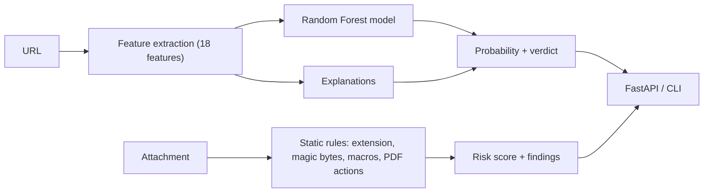

# 🛡️ Phishing & Identity Threat Detector

A machine learning tool in Python that **detects phishing links** and **flags malicious email attachments**, and explains *why* each item looks dangerous. Built as a teaching model for cybersecurity and AI trainees: every feature is readable, every verdict comes with reasons.

[](https://github.com/nora-albabtain/phishing-threat-detector/actions/workflows/ci.yml)

---

## What it does

| Module | Approach | Output |
|---|---|---|
| **URL scanner** | Random Forest classifier on 18 engineered URL features | Phishing probability, verdict (`safe` / `suspicious` / `phishing`), and plain-language reasons |
| **Attachment scanner** | Static, rule-based analysis (nothing is executed) | Risk score 0–100, verdict (`low` / `medium` / `high`), and findings |

**URL features** include URL and host length, number of subdomains, raw IP addresses, the `@` trick, HTTPS use, phishing keywords (login, verify, account...), URL shorteners, risky TLDs, embedded redirects, punycode look-alikes, and host entropy.

**Attachment checks** include executable and script types, double extensions (`invoice.pdf.exe`), hidden right-to-left override characters, macro-enabled Office files, embedded VBA macros, content that does not match its extension (magic bytes), and PDFs with JavaScript or Launch actions.

## Architecture



## Quick start

```bash
git clone https://github.com/nora-albabtain/phishing-threat-detector.git
cd phishing-threat-detector
pip install -r requirements-dev.txt

python data/generate_sample.py                          # create the demo dataset
python -m detector.cli train --data data/sample_urls.csv
python -m detector.cli url "http://secure-login-mybank-verify.xyz/account/update.php?token=12345"
python -m detector.cli file path/to/attachment.pdf
```

Example output:

```json
{
  "url": "http://secure-login-mybank-verify.xyz/account/update.php?token=12345",
  "phishing_probability": 1.0,
  "verdict": "phishing",
  "reasons": [
    "Contains words often used in phishing (login, verify, account...)",
    "Uses a top-level domain frequently abused for phishing",
    "Does not use HTTPS"
  ]
}
```

### REST API

```bash
uvicorn app.api:app --reload       # docs at http://localhost:8000/docs
```

| Method | Endpoint | Description |
|---|---|---|
| GET | `/health` | Health check |
| POST | `/scan/url` | `{"url": "..."}` → verdict and reasons |
| POST | `/scan/attachment` | Upload a file → risk score and findings |

### Docker

```bash
docker build -t phishing-threat-detector .
docker run -p 8000:8000 phishing-threat-detector
```

## About the data (important)

The repository ships a **synthetic** dataset generator (`data/generate_sample.py`). Its phishing examples are invented from common patterns with fictional brand names; they are **not real phishing links**. Because the patterns are clean, the model scores near 100% on this demo data, which is **not** a realistic estimate.

For realistic results, retrain on a labelled public dataset (for example, phishing URL datasets published on Kaggle or feeds such as PhishTank and OpenPhish) in a CSV with two columns, `url` and `label` (1 = phishing, 0 = legitimate):

```bash
python -m detector.cli train --data path/to/real_dataset.csv
```

Training prints accuracy, precision, recall, F1, the confusion matrix, and the most important features, and saves them next to the model.

## Teaching notes

This project is used to teach:

- **Feature engineering**: turning raw text (URLs) into meaningful numbers.
- **Model evaluation**: why **recall** matters when missing a phishing link is costly, and why near-perfect scores on clean data are a warning sign (data leakage and unrealistic datasets).
- **Explainable AI**: giving users reasons, not just a score.
- **Defense in depth**: combining an ML model (URLs) with deterministic rules (attachments).
- **Adversarial thinking**: how attackers evade detectors (look-alike domains, shorteners) and how to improve features.

## Limitations

- URL analysis is lexical only; it does not visit the page, check domain age, or query reputation services.
- Attachment analysis is static and heuristic; it is not a replacement for antivirus or sandboxing.
- Use as an educational and first-line screening tool, not as a sole security control.

## Project structure

```
phishing-threat-detector/
├── detector/
│   ├── features.py      # URL feature extraction + explanations
│   ├── model.py         # training, evaluation, prediction
│   ├── attachments.py   # static attachment risk analysis
│   └── cli.py           # command-line interface
├── app/api.py           # FastAPI service
├── data/generate_sample.py
├── tests/               # unit and API tests
├── Dockerfile
└── .github/workflows/ci.yml
```

## Author

**Nora Albabtain** — AI & Cybersecurity Instructor · [GitHub](https://github.com/nora-albabtain) · [LinkedIn](https://linkedin.com/in/nora-albabtain-916017336)

## License

MIT
